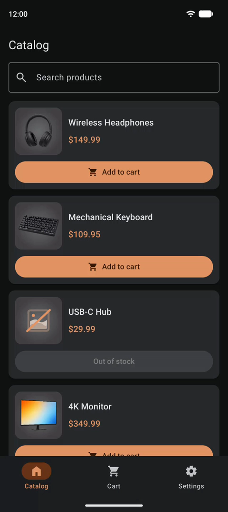
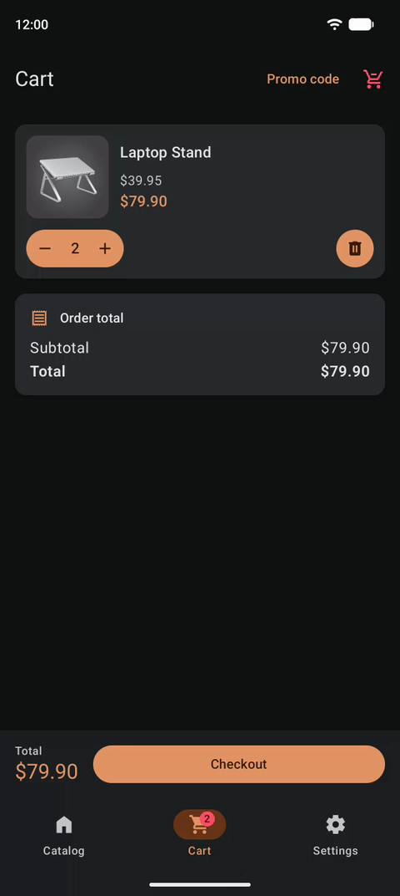
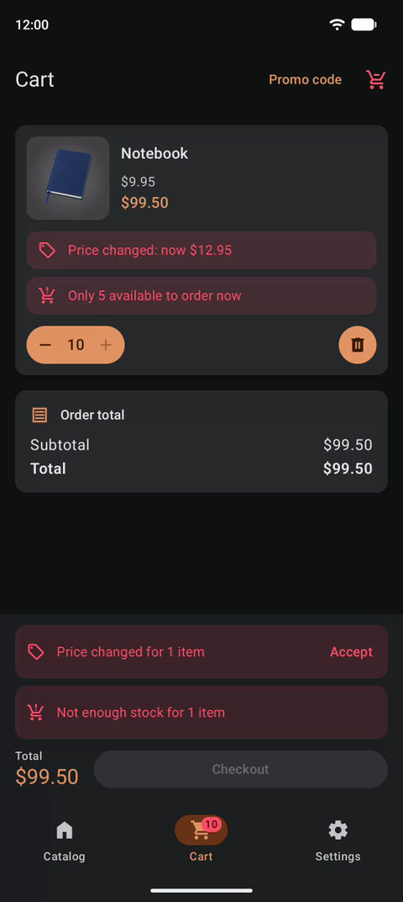

# ShoppingApp

[](https://github.com/dmitriiecho/ShoppingApp/actions/workflows/ci.yml)

[Русская версия](README.ru.md)

ShoppingApp is an example app for Android and iOS built on a modern stack. The repo contains two apps:

- **Shop**: a demo store with a searchable catalog, a cart that lives on the device and is checked against the server, promo codes and checkout. It works on Android and iOS phones and tablets, from the same Kotlin Multiplatform code.
- **UI kit**: a showcase of every styled component in the shop, grouped into sections, with a light and dark theme switch, on Android and iOS. It lets you browse and check the design without going through the shop itself.

&nbsp;

## Variants

The same app is built on three slightly different stacks, each in its own branch:

| Branch | Platforms | DI | Network | Logging | Download |
|---|---|---|---|---|---|
| [`main`](https://github.com/dmitriiecho/ShoppingApp/tree/main) | Android | Hilt | Retrofit + OkHttp | Timber | [APK](https://github.com/dmitriiecho/ShoppingApp/releases/download/main-latest/ShoppingApp.apk), [UI kit APK](https://github.com/dmitriiecho/ShoppingApp/releases/download/main-latest/ShoppingApp-UiKit.apk) |
| [`kmp-ready`](https://github.com/dmitriiecho/ShoppingApp/tree/kmp-ready) | Android | Metro | Ktor | Kermit | [APK](https://github.com/dmitriiecho/ShoppingApp/releases/download/kmp-ready-latest/ShoppingApp.apk), [UI kit APK](https://github.com/dmitriiecho/ShoppingApp/releases/download/kmp-ready-latest/ShoppingApp-UiKit.apk) |
| **`kmp`** | Android, iOS | Metro | Ktor | Kermit | [APK](https://github.com/dmitriiecho/ShoppingApp/releases/download/kmp-latest/ShoppingApp.apk), [UI kit APK](https://github.com/dmitriiecho/ShoppingApp/releases/download/kmp-latest/ShoppingApp-UiKit.apk) |

All variants share Compose, Navigation Compose, Room and DataStore. In `kmp` they are the multiplatform versions (Compose Multiplatform), and the shop's screens, logic and data are shared code that runs on both platforms.

Each branch comes with two APKs: the shop and the UI kit. The iOS apps are built from the code (see [Running](#running)).

&nbsp;

## The `kmp` variant: Android and iOS

- **Four apps from one branch**: the shop and the UI kit, each for Android and for iOS.
- **Phones and tablets** on both platforms.
- **Almost all code is shared**: the UI in Compose Multiplatform, the ViewModels, navigation, data and network live in common modules, written once for both platforms. Each platform keeps only its entry point and a few platform details.

&nbsp;

## How it looks

The three main flows, from left to right: the catalog, the cart with a promo code, and changes from the server followed by checkout.

<p>
  
  
  
</p>

&nbsp;

## What's inside

The app is small, but every screen has something worth a look:

- **Catalog**: search that waits until you stop typing, pages loaded from the server, and the product image flying into the details screen.
- **Cart**: stored only on the device (Room). The server keeps no carts; it checks this one each time the cart is opened and before checkout, and reports removed items, new prices and low stock.
- **Promo codes**: checked by the server, with the discount shown right in the totals.
- **Checkout**: the form survives process death, and a double tap won't place the order twice.
- **Deep links** to the catalog, the cart and a product: verified App Links on Android, the app's own `shoppingapp://` links on iOS.
- **Settings**: the theme, a request delay, and test items that put every kind of change into the cart.
- **Tablets and wide screens**: the content stays in a centred column, and in landscape the product screen puts the image and the details side by side ([more](docs/architecture/en/screens.md#wide-screens)).

&nbsp;

## Architecture

The modules are arranged in four levels, and the build checks that no module depends on a level above its own:

```text
apps/         shop, uikit (each: shared, android, ios)       the applications: shared code and each platform's entry
feature/      catalog, cart, promo, checkout, settings       each one is ui + impl
crossfeature/ domain, data, ui, analytics                    shop code used by two or more features
core/         designsystem, compose-utils, network, config   knows nothing about the shop
```

How modules, navigation, screens, data, analytics and the build work is explained in the [architecture docs](docs/architecture/en/README.md).

&nbsp;

## Tests and CI

- **Tests** run on the JVM and cover the logic, the ViewModels, the data layer, the contract with the server, and a screenshot of every preview. The tests of the shared code also run on the iOS simulator.
- **CI** runs on every pull request: code style, module rules, unused dependencies, lint, tests and a build of both Android apps, and on macOS the iOS tests and a build of both iOS apps. It posts changed screenshots in a comment on the pull request, and rebuilds the APKs after every change to `main`.

&nbsp;

## Running

The easiest way is to download the [APK from `main`](https://github.com/dmitriiecho/ShoppingApp/releases/download/main-latest/ShoppingApp.apk). It is a release build for Android 8.0 and newer, rebuilt by CI after every code change to `main`. The [UI kit APK](https://github.com/dmitriiecho/ShoppingApp/releases/download/main-latest/ShoppingApp-UiKit.apk) is published next to it.

To build the apps yourself, you need JDK 21 and the Android SDK:

```sh
./gradlew :apps:shop:android:installDebug   # installs the shop on a connected device
./gradlew :apps:uikit:android:installDebug  # installs the UI kit
```

The iOS apps build on a Mac with Xcode and JDK 21: open `apps/shop/ios/iosApp.xcodeproj` (the shop) or `apps/uikit/ios/iosApp.xcodeproj` (the UI kit) and run it on a simulator ([more](docs/architecture/en/build.md#ios-app)).

&nbsp;

## Server

The catalog, promo codes and cart checks are served by a small Ktor server in [`server/`](server/README.md). It is deployed at `http://2.56.204.151:8080/`, and both debug and release builds use it.

&nbsp;

## Built with AI agents

The app is built with the AI agents Claude Code, Cursor and Grok Build, running on Claude Opus and Grok models. Agents speed up the work a lot, but they don't write good code on their own: they need rules, step-by-step guidance, and someone to check their output. Here is how that works in this project:

- **The rules are written down for the agents**: [CLAUDE.md](CLAUDE.md) describes the module layout, the code style and the conventions for screens.
- **Changes are made in small steps**, and each one is discussed and checked before it is committed.
- **Behaviour is checked by tests and CI** (see [above](#tests-and-ci)), and every change is also tried out on an Android emulator and, for iOS, on a simulator.
